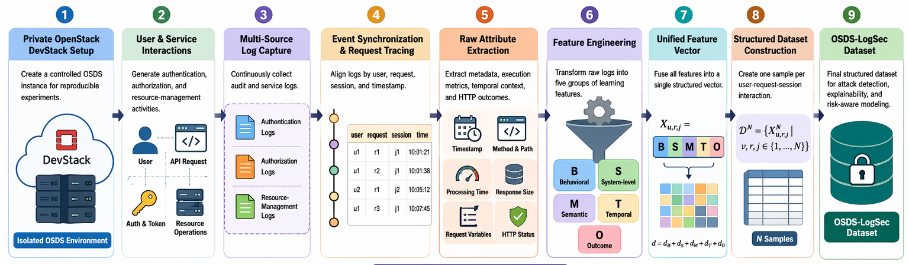

# RAVEN-ADE++

Risk-Adaptive Variational Ensemble Network for Attack Detection and Explainability

### 1. OSDS-LogSec Dataset

The project introduces the OpenStack DevStack Log Security Dataset (OSDS-LogSec Dataset), a structured cloud-security dataset collected from a private OpenStack DevStack deployment.

The dataset contains:

| Property | Value |
|---|---:|
| Total Samples | 444,602 |
| Normal Samples | 222,302 |
| Attack Samples | 222,300 |
| Raw Features | 18 |
| HyperGraph-Augmented Features | 27 |
| Train Samples | 302,328 |
| Validation Samples | 53,353 |
| Test Samples | 88,921 |
| Class Balance | 50 / 50 |

The dataset contains five attack families:

1. DoS
2. Payload Injection
3. Header Flood
4. API Abuse
5. Insider Mimic

---

## OSDS-LogSec Dataset Workflow

  

The dataset workflow starts with a private OpenStack DevStack deployment where authentication, authorization, and resource-management events are logged. Audit logs and service logs are synchronized by user, request, session, and timestamp. Raw metadata, execution statistics, semantic context, and temporal information are extracted and converted into structured features.

The final dataset combines:

- Behavioral features
- System-level features
- Semantic features
- Temporal features
- Outcome features

---

The framework is composed of eight major modules.

| Module | Description |
|---|---|
| Module 1 | Data cleaning, encoding, normalization |
| Module 2 | Risk-Adaptive Attack Injection and Labeling |
| Module 3 | Train, validation, and test partitioning |
| Module 4 | HyperGraph contextual augmentation |
| Module 5 | Risk-Adaptive Encoder |
| Module 6 | Attention-Based Risk Weighting |
| Module 7 | Supervised Variational Latent Learning |
| Module 8 | Binary attack classification head |

---

Based on the proposed RAVEN-ADE++ framework and OSDS-LogSec dataset described in the accompanying paper. fileciteturn4file0

